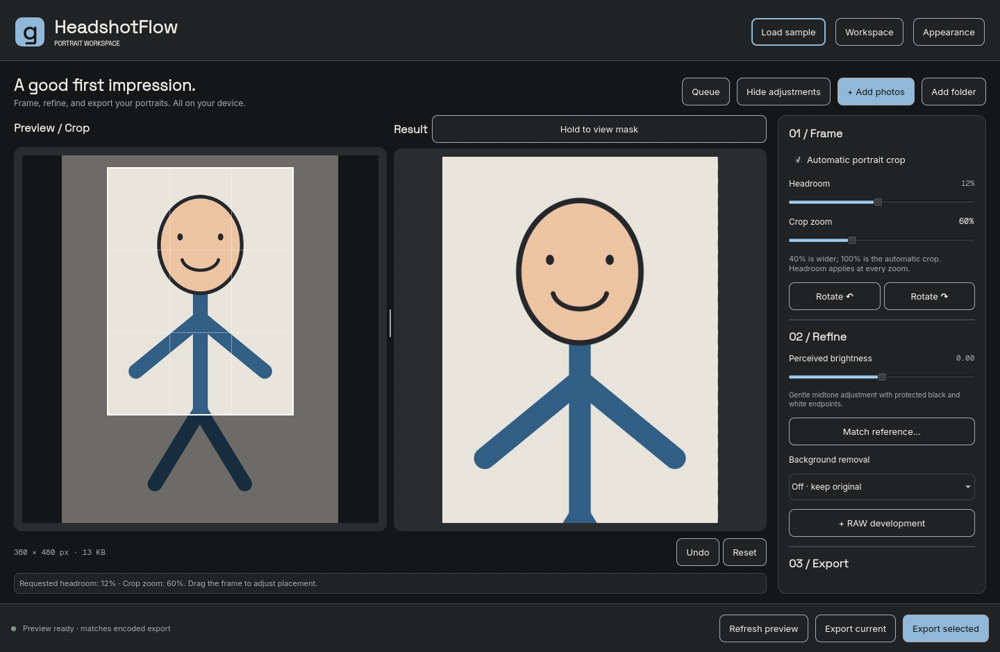

# HeadshotFlow quickstart

Install HeadshotFlow from [Releases](https://github.com/wispdevon/GibbonPfp/releases)
or follow the [build instructions](BUILDING.md). The desktop launcher is named
**HeadshotFlow**. The terminal command is `gibbonpfp`.
On Linux, a per-user test install can also be launched with
`~/.local/bin/gibbonpfp`. Close any running copy before launching a newly
installed build.

## Export the sample batch

1. Choose **Load sample** in the slim toolbar. HeadshotFlow adds three generated
   portrait samples to the queue and checks them. Loading the sample again returns
   to the first existing sample, adds any missing entries, and keeps existing
   samples’ settings and checked states.
2. Use **Previous** and **Next** below the preview to move through the queue. Open
   the inspector with the sliders icon if it is hidden. Its tabs are **Frame** and
   **Refine**. In **Frame**, adjust **Headroom** and **Crop zoom**, drag the crop,
   or focus the crop and use the arrow keys. Lower crop zoom values show more of
   the source. Drag the dividers between panels to change their widths, or focus
   a divider with **Tab** and use **Left** or **Right**.
3. **Preview / Crop** shows the full oriented source and an editable crop outline.
   **Result** shows the decoded output for the open photo using
   that photo’s current settings. Changes made in **Export as…** do not change this
   editor preview. In **Refine**, choose **Fast · portrait**, **High Quality ·
   portrait**, or **Off · keep original** under **Background removal**. With
   removal enabled, choose **Keep brush** or **Remove brush** and paint on
   **Result** to correct the current photo’s mask. Use **Clear strokes** to remove
   its brush corrections. Framing edits clear strokes.
4. Choose **Export as…** to review the export scope and options. On a fresh setup
   with the three samples checked and no previous successful export, it defaults
   to **Checked photos (3)** with **Use each photo’s output settings** enabled. The
   first click on **Quick Export** also opens **Export as…** when there is no
   remembered successful destination. Click **Choose folder…**, select the
   destination, and confirm. In Linux’s native folder picker, a typed path may
   navigate into that directory, so select the intended folder and click **Open**.
   The output folder includes a JSON report. The default is a JPEG capped at
   360 × 480 pixels. When you choose a shared style, **Export as…**
   also lets you choose another size, PNG, filename prefix, JPEG quality and
   backdrop, and screen sharpening.

The slim toolbar contains **Add photos…**, **Add folder…**, and **Load sample**.
The queue button shows or hides the photo list. The inspector button shows or hides
the **Frame** / **Refine** panel. **Workspace actions** contains **Open session…**,
**Save session…**, **Load preset…**, **Save preset…**, **Appearance…**, and
**Models…**. **Photo actions** contains **Apply to all…**, **Fully automatic batch**,
**Undo**, **Reset photo**, and **Refresh preview**. **Queue actions** contains
**Prepare selected** and **Remove selected**.

## Choose the export scope

The **Photos** selector in **Export as…** offers three scopes.

| Scope | Photos included |
| --- | --- |
| **Current photo** | The open photo, whether or not it is checked |
| **Checked photos (N)** | Checked photos, including those hidden by the queue filter |
| **Whole queue ZIP (N)** | Every photo in the queue, saved in one ZIP |

When exporting checked photos or the whole queue, **Use each photo’s output
settings** exports each photo with its assigned output format, size, filename
prefix, and related settings. Turn it off to choose one shared output style for the
batch. **Quick Export** repeats the last successful export’s scope, settings, and
destination. If that destination is unavailable, it opens **Export as…** to choose
another. If the remembered ZIP already exists, the dialog asks before replacing it.

Loading a preset with **Workspace actions → Load preset…** changes the open
photo’s settings. It does not change the other photos or future-import defaults.
For the next **Quick Export**, that preset takes precedence over a remembered
shared output style, while the last successful scope and destination are retained.
When **Use each photo’s output settings** is on, each photo uses its own assigned
settings.

The queue shows how many photos are checked and reports checked photos hidden by
the current filter. **Prepare selected** and **Remove selected** operate on all
checked photos, including hidden ones. Use **All photos** to show the whole queue.
Edits and undo apply to the open photo. Confirm **Apply to all…** to copy its
settings to every queued photo and future imports. This resets manual framing,
brush strokes, and approvals. Approval is per photo. For **Needs review**, read the
warning and adjust the crop or choose **Approve current framing** when satisfied.

Folder exports keep any photos successfully saved before a hold, failure, or
cancellation and write a JSON report. A ZIP is completed only after every photo
passes processing and review. A failure or cancellation leaves an existing
destination unchanged.

## Keyboard controls

| Key | Action |
| --- | --- |
| **Tab** / **Shift+Tab** | Move focus through controls |
| **Arrow keys** in Preview / Crop | Move the focused crop frame |
| **Left** / **Right** on a focused divider | Resize adjacent panels |
| **Alt+Left** / **Alt+Right** | Open the previous or next photo in the filter |
| **Alt+Shift+R** | Open the next other photo needing review across the queue |
| **Ctrl+Return** | Refresh the preview |
| **Ctrl+O** / **⌘O** | Open the Add photos to the queue dialog |
| **Ctrl+Z** / **⌘Z** | Undo the last change to the current photo |

See the [README](../README.md#desktop-usage) for background removal details,
appearance options, saved sessions, and model information.
